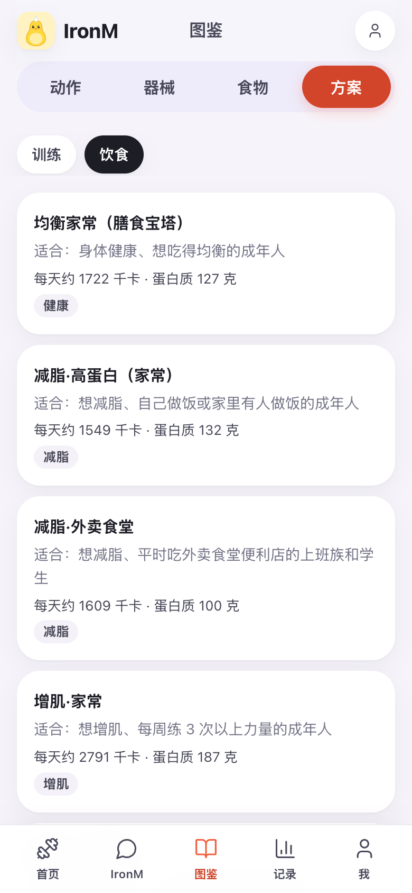
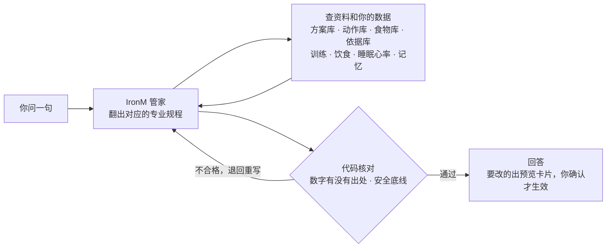

<div align="center">

# IronM — 你的健身 AI 管家

**认识你、看得懂你的数据、说话有依据。**<br/>
数字由代码算，每条建议都能追溯到依据；数据在你自己电脑上，模型用你自己的。

[](LICENSE)


[](https://github.com/thetahealth/mirobody)


[看它怎么回答](#-看它怎么回答) · [有什么不同](#-和你用过的有什么不同) · [功能](#-功能) · [快速开始](#-快速开始) · [它怎么想](#-它怎么想) · [隐私](#-隐私和安全)

<br/>





</div>

---

## 💬 看它怎么回答

下面是两周模拟测试里，模拟用户和 IronM 的**真实对话**（模型用的 DeepSeek，用户的训练和身体数据是模拟的，回答原样摘录）：

> **🧑 昨晚只睡了 5 个小时，今天还练吗？**
>
> **🤖 IronM：** 今天照练，但按七成来，别硬顶。昨晚只睡 5 小时，最近 3 晚平均 6.5 小时，比你平时 7.2 小时少 2.2 小时；静息心率 62 次/分，和平时一样，所以不用停练，收着点练就行。
> 1. 今天全身 B 每个动作的组数按原来的约 7 成，重量不往上加，罗马尼亚硬拉先按上次的重量
> 2. 每组做完还剩 2–3 次就停，多关节动作组间休息 2–3 分钟
> 3. 练完早点睡，今晚争取睡够 7 小时以上

> **🧑 练了一周，体重一点没动，是不是要再少吃点？**
>
> **🤖 IronM：** 不用再少吃。一周看不出变化，你的体重这 30 天基本持平，先别动热量。最近 30 天头一周平均 66.0 公斤、最后一周 65.9 公斤，变化没超过日常波动；单次称重受水分、糖原影响，一周内本身就有约 0.35%（约 0.3 公斤）的波动。
> 1. 每天早上空腹、上完厕所后称一次，连着记两周，看周平均而不是单天
> 2. 这周三次力量照计划练，蛋白质每天 105–132 克、每餐 20–25 克，热量按 1348 千卡吃
> 3. 两周后周平均还不降，再谈减热量；一次只改一样，缺口每天不超过约 500 千卡

> **🧑 下周一到周三要出差，酒店健身房只有一对哑铃，最重 20 公斤。**
>
> **🤖 IronM：** 能练，这三天把周一、周三的器械动作换成哑铃版，我已经出了临时调整的预览，你确认后生效。你周一、周三的箱式深蹲、绳索划船、罗马尼亚硬拉、高位下拉都要器械，酒店只有一对哑铃。你膝盖有伤，深蹲类动作要控制下蹲深度、用轻重量，蹲到大腿接近平行就停，出现膝痛就停。
> 1. 周一：哑铃高脚杯深蹲（控制下蹲深度、用轻重量，蹲到大腿接近平行就停，膝痛就停）、哑铃卧推、单臂哑铃划船、臀桥、死虫式，组次照原计划
> 2. 周三：哑铃罗马尼亚硬拉、哑铃俯身划船、哑铃推举、高脚杯深蹲（控制下蹲深度、用轻重量，蹲到大腿接近平行就停，膝痛就停）、平板支撑，组次照原计划
> 3. 哑铃最重20公斤，重量选做完还剩2–3次的，深蹲蹲浅一点、左膝疼就停
>
> 周四回健身房后按原计划练，重量照上次的来。
>
> 下面是临时调整的预览，点「确认」才生效，到了结束日期自动回到原计划，也能提前撤销。
>
> *（回答下面附着那张临时调整的预览卡片）*

它记得你膝盖伤过、知道你平时睡几个小时、看得到你的体重趋势；要改计划，就先给你一张预览卡片，你点确认才算数。

## 🆚 和你用过的有什么不同

| | 普通健身记录 App | 直接问通用 AI | **IronM** |
|---|:---:|:---:|:---:|
| 记得你的伤病、器械、作息、喜好 | ❌ | 聊完就忘 | ✅ 长期记忆，能看能删 |
| 看你的训练、饮食、睡眠心率、化验单 | 只看自己记的 | ❌ | ✅ |
| 直接帮你改计划、定今天练多少、定下次重量 | ❌ | 只给建议 | ✅ 出预览，你确认才生效 |
| 热量、营养素、训练量这些数字 | 自己算 | 模型估，可能编 | ✅ 代码按食物库和公式算 |
| 说法有没有依据 | — | 不一定 | ✅ 125 条指南、立场声明、随机试验，追问就讲出处 |
| 急症、高血压、孕期、伤处这些安全底线 | — | 靠提示词 | ✅ 写在代码里 |
| 你的数据在哪 | 厂商服务器 | 厂商服务器 | ✅ 你自己电脑上 |

## ✨ 功能

- **🏋️ 训练**：12 份训练方案按你改成计划；每天看你的睡眠、心率和你说的，定今天怎么练；出差生病有临时调整，到期自动恢复；训练记录器逐组记；下次练多重按记录定。
- **🥗 饮食**：拍一张或说一句就记一餐；11 份整天的饮食方案一键套用（减脂、增肌、地中海、DASH 控血压、控糖、素食……）；130 种食物、50 个家常食谱。
- **📊 身体数据**：化验单、体检报告拍照识别，导入苹果健康、手表数据；每项和你自己的平时比。
- **🧠 记忆**：记得你说过的伤病、器械、安排和喜好；推测的会过期，记错了能删。
- **📚 依据**：125 条依据（中国居民膳食指南、国家卫健委指导原则、ACSM、ISSN、NEJM 随机试验……），每条写明来源和原文位置。

<details>
<summary><b>展开看完整功能</b></summary>

### 🏋️ 训练

- **从方案库起步，按你改**：12 份训练方案（入门全身、上下肢分化、推拉腿、居家、时间少、60 岁以上……），按你的水平、每周天数、器械、伤病和时间，换成适合你的动作和组次。
- **今天怎么练，每天看一眼**：结合你的睡眠、静息心率、心率变异性和你说的（"今天有点累""只有 30 分钟"），决定今天按几成练、换不换动作；出错了如实说、能重试，不偷偷套规则。
- **临时调整**：出差、生病、减量周写明从哪天到哪天，到期自动回到原计划，不会把你的计划改乱。
- **训练记录器**：逐组记重量和次数（点数字直接填），组间休息倒计时和提醒，练完出一张分享卡。
- **下次目标**：做满了就加，没做满就稳住，没定的照上次。
- **动作图鉴**：115 个动作，带配图、动图、要点和替代动作；34 种器械，能拍照认器械。

### 🥗 饮食

- **拍一张或说一句就记一餐**：模型只负责认出吃了什么、多少克，热量和营养素按食物库算。
- **饮食方案库**：均衡家常（膳食宝塔）、减脂高蛋白、外卖食堂减脂、增肌家常、上班带饭增肌、地中海、DASH 控血压、控糖、蛋奶素、60 岁以上高蛋白、限时进食。每份写明适合谁、不适合谁、热量和三大营养素怎么定；份量按你的热量目标自动缩放，套了不满意能撤销。
- **饮食账单**：今天还能吃多少；每顿照计划记或记实际吃的；130 种食物、50 个家常食谱、12 份外卖食堂常见餐。
- **热量目标**：按基础代谢和活动量算；要不要调由 IronM 看你的记录决定，代码只守边界：不低于基础代谢和安全下限，单次不超过 300 千卡、累计不超过 500 千卡。

### 📊 身体数据

- 底座是 [mirobody](https://github.com/thetahealth/mirobody)：化验单、体检报告拍照识别，导入苹果健康，接入手表数据。
- 每项指标和你自己的平时比、和标准比；不贴"状态差"这种笼统标签，只给数和差。

### 🔐 账号与隐私

- 邮箱加密码注册，不配发信也能用；随时导出数据、注销账号。

</details>

<details>
<summary><b>展开看页面一览</b></summary>

底部五个标签：**首页 · IronM · 图鉴 · 记录 · 我**，网页版和手机 App 一样。

| 页面 | 里面有什么 |
|---|---|
| **首页** | 今日委托：今天练什么、IronM 有没有调整过、开始训练、已经练完直接打卡；今天吃：还能吃多少千卡、三大营养素、拍照记、写一句；今日热搜（排行榜） |
| **IronM**（对话） | 想问什么直接问；排计划、改计划、记一餐、改目标都出预览卡片，确认才生效、能撤销；IronM 主动发来的消息（今天的调整、待你确认的建议）；每周一次的周报；能拍照发给它 |
| **图鉴** | 动作：115 个动作，按部位和器械筛，配图、动图、要点、替代动作、你的历史最佳；器械：34 种，拍照认器械；食物：食材、家常食谱、记一餐；方案：训练方案库（12 份）和饮食方案库（11 份），看完一键用 |
| **记录** | 这周表现：练了几次、累计时长、完成组数、破了几个 PR、周目标完成度、和上周比；身体数据趋势；训练时间线（带打卡照片，能晒成分享图）；成就 |
| **我** | 资料卡和我的目标（预计哪天到）；器材和场所、城市和天气（能用当前位置）、训练日提醒（手机 App）；身体数据、IronM 记得的事（能删）、导入健康数据和化验单、我的文件；模型和 API；账号与隐私 |
| **训练计划** | 一周七天怎么练；直接改：换动作、调组数次数、去掉、排顺序；每个动作的下次目标 |
| **训练中** | 训练记录器：逐组记、组间休息倒计时、加一组、计时；练完出练完的卡 |
| **饮食账单** | 今天还能吃多少、目标怎么算的；按顿列吃什么，照计划记或记实际吃的；饮食计划随时改 |
| **身体数据** | 常看的指标在前；每项和你自己的平时比、和标准比；能自己记一条、改错的 |
| **排行榜** | 健身餐、补剂、蛋白粉、器材、训练计划的榜单，大家投票、评论 |

</details>

## 🚀 快速开始

> 现在还没有大家共用的服务器：每个人在自己电脑上跑一份，用浏览器打开网页版。

你需要：**一台电脑**和**一个你自己的大模型密钥**。比如 [DeepSeek](https://platform.deepseek.com)，充几块钱能用很久；也支持通义千问、智谱、豆包、Kimi、OpenAI 和任何兼容 OpenAI 格式的服务。

**方式一：Docker**（Windows、Mac、Linux 都行）

```bash
git clone https://github.com/liua8/ironm.git iron-m && cd iron-m
docker compose up -d
```

**方式二：一条命令的脚本**（Mac、Linux，不用装 Docker）

```bash
curl -LsSf https://astral.sh/uv/install.sh | sh   # 没有 uv 的先装，装完重开终端
git lfs install
git clone https://github.com/liua8/ironm.git iron-m && cd iron-m
scripts/start.sh
```

第一次要装环境、数据库和配图，十几分钟；以后几秒钟。然后：

1. 打开 <http://127.0.0.1:18090/iron/>，**注册**（邮箱就是登录名），填好身高、出生日期、体重。
2. 到 **「我 → 模型和 API」** 填你的模型密钥，点"测试连接"。
3. 跟 IronM 说一句："我想开始练，每周 3 次，在健身房。"

不熟悉终端？照 [deploy/self-host.md](deploy/self-host.md) 一步步来：怎么装工具、怎么申请模型密钥、端口被占、国内下载慢、怎么停、怎么更新，都写了。

## 🧭 它怎么想

IronM 是**一个 AI 管家**（单 Agent）。训练、饮食、恢复、身体数据、App 怎么用，都是它一个人答：问到哪一类，它先翻出那一类的专业规程（排训练计划、动作教学、营养、今天练不练、伤痛处理、看数据、记录复盘、建档，共 8 份），再查方案库、动作库、食物库、依据库和你的数据，最后作答。

你不在的时候，它也在干活：每天第一次打开时看一眼今天怎么练，练完定下次的重量，每周复盘一次，对话之后整理该记住的事。



设计原则只有一条：**判断交给 AI，代码只做三件事。**

| 代码做的 | 交给 AI 的 |
|---|---|
| **算事实**：热量、基础代谢、营养素、训练量、和你平时比的差 | 今天练不练、按几成练 |
| **守底线**：急症、危急指标拦训练、特殊人群硬规则、伤处不受力、热量下限、加减重上限 | 下次加多少重量 |
| **管机制**：存储、到期、去重、撤销、把改动套到计划上并检查 | 要不要改计划、提不提醒你 |

AI 出错了，不会退回"规则"偷偷替你决定，而是如实告诉你"出错了，可以重试"。

## 🔒 隐私和安全

- **数据在你自己手里**：自己部署，账号、记录、身体数据都存在你自己电脑的数据库里，敏感内容加密存放。
- **模型用你自己的**：问的话和照片只发给你自己选的模型服务商，中间没有任何"官方服务器"。
- **随时导出、随时注销**：在「我 → 账号与隐私」里下载你的数据；注销后，IronM 里你的数据马上删除。
- **它不是医生**：IronM 的建议仅供参考，不能代替医生、营养师或康复师。胸痛、头晕、呼吸困难请立刻停止并就医。

觉得有用，点个 ⭐ 让更多人看到。有想法欢迎提 Issue。

## 🛠️ 开发

| | |
|---|---|
| 后端 | Python 3.13 · FastAPI · PostgreSQL + pgvector；以插件方式接在 [mirobody](https://github.com/thetahealth/mirobody) 上 |
| 网页 | 原生 JavaScript，不加载外部资源 |
| App | React Native · Expo · TypeScript（`app/`） |

本机开发需要 uv、git-lfs、micromamba（都可装在 `~/.local/bin`，不需要管理员权限）：

```bash
git lfs install && git lfs pull   # vendor/mirobody 里两个大数据文件走 git-lfs
cp .env.example .env              # 填写各项，然后 chmod 600 .env
make setup                        # Python 环境
make pg-install pg-init           # 本机 PostgreSQL 18 + pgvector，只监听 127.0.0.1:55432
make run                          # http://127.0.0.1:18090
cd app && npm install && npm run web       # 手机 App 的网页预览
```

开发模式下有演示账号 `you@mirobody.ai`，验证码 `111111`（mirobody 自带的合成数据）。

`vendor/mirobody` 是 mirobody 1.5.8 原样（本仓库里的普通目录，不是子模块，见 `vendor/mirobody/IRON-M.md`）。IronM 通过 mirobody 官方的 `mirobody.agents` 插件接口接进去，没有改它的代码。

## 🙏 致谢

- [mirobody](https://github.com/thetahealth/mirobody)：健康数据底座。
- 动作配图来自 [wger](https://wger.de) 和 [Everkinetic](https://github.com/everkinetic/data)（CC BY-SA），食物照片来自 Unsplash、Pexels，排行榜配图来自 Wikimedia Commons；每张的作者和许可写在 `ironm_agent/*_images.yaml`，页面上署名。配图不在仓库里，安装时按清单从原网站下载。
- 食物营养数据参考 USDA FoodData Central（公有领域）。

## 📄 许可

[Apache License 2.0](LICENSE)。`vendor/mirobody` 按它自己的 Apache-2.0 许可（见 `vendor/mirobody/LICENSE`、`LICENSE-3RD-PARTY`）。
