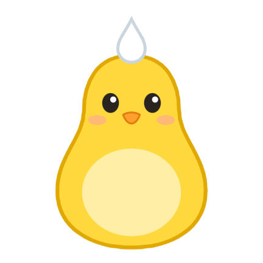
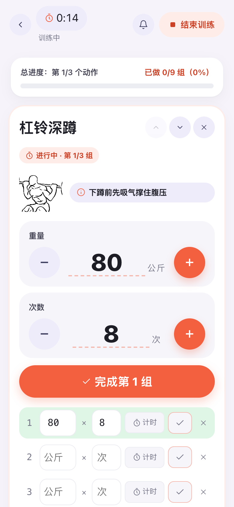
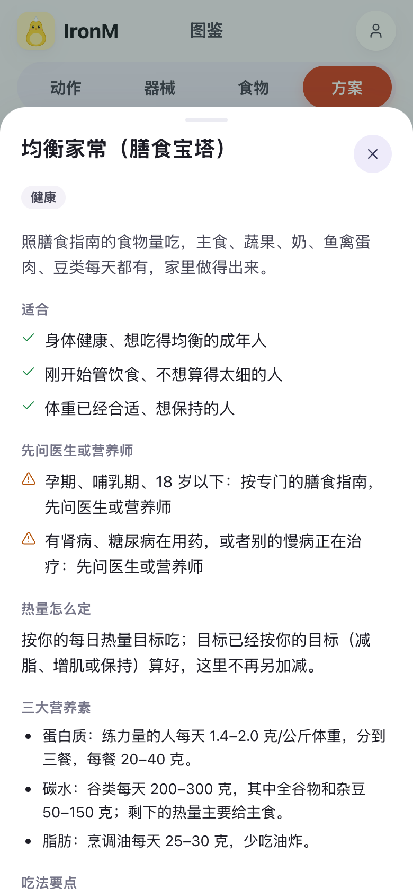
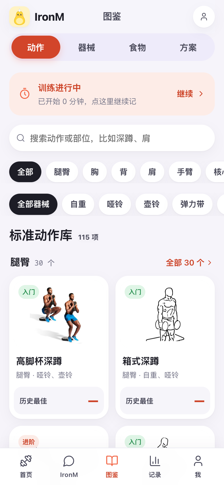
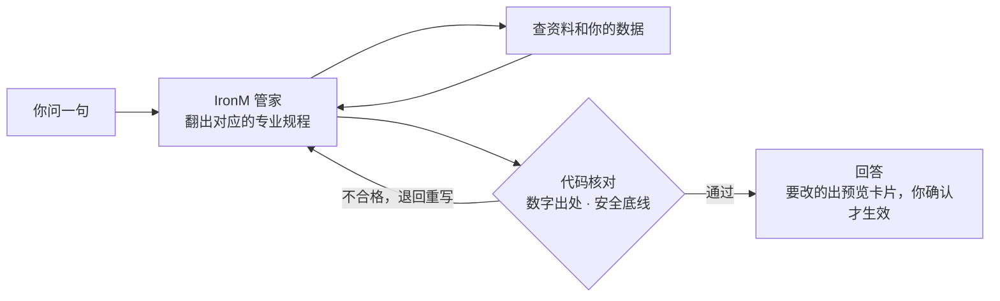

<div align="center">



# IronM

### 你的健身 AI 管家

**训练、饮食、恢复，一个 AI 管家一起管。**<br/>
它记得你、看得懂你的数据，说的每句话都有依据；数据留在你自己电脑上。

[](LICENSE)


[](https://github.com/thetahealth/mirobody)

[为什么要一起管](#-为什么要一起管) · [亮点](#-亮点) · [看它怎么回答](#-看它怎么回答) · [快速开始](#-快速开始) · [常见问题](#-常见问题)

<br/>






</div>

<br/>

练、吃、恢复本来是一件事：没睡好，今天就该练轻一点；练得狠，就得吃够蛋白质；减脂体重不动，不能只盯着少吃。可现在它们被拆进了好几个 App：训练 App 只管动作和组数，饮食 App 只管卡路里，手环只告诉你昨晚睡得少，谁也不看谁，最后还得你自己来拼。

**IronM 把三样交给同一个管家。** 它同时看得到你的训练、饮食、睡眠心率和化验单，记得你的伤病和习惯；排计划、调今天的训练量、定下次的重量、改热量，都是在看过全部之后一起定的。每一处改动先给你看，你点确认才生效。

## 🔗 为什么要一起管

只管一样的工具，各自都"对"，合起来却常常打架。IronM 解决的就是这些：

| 你遇到的情况 | 只管一样的 App | IronM |
|---|---|---|
| **昨晚只睡了 5 小时** | 训练 App 照常推原计划；手环只告诉你睡得少 | 拿你最近的睡眠、静息心率和你平时比，决定今天照练、按几成练还是休息 |
| **感冒发烧** | 训练 App 还在提醒你打卡 | 今天停练；好了以后先按几成练一周，不急着回原来的重量 |
| **减脂一周体重没动** | 饮食 App 让你再少吃一点 | 看 30 天的体重趋势、你吃了多少、练了几次，先别乱减热量，保住力量训练 |
| **想增肌** | 训练和饮食各算各的目标 | 同一个目标：训练计划按增肌排，热量和每公斤体重的蛋白质按增肌定，饮食方案份量跟着热量走 |
| **出差只有一对哑铃** | 计划作废，回来重新排 | 这几天临时换成哑铃版，记得你膝盖伤过、深蹲控制深度，到期自动回到原计划 |
| **每周回头看** | 训练图表、饮食图表、睡眠图表各看各的 | 把练了几次、吃了多少、体重趋势、睡眠心率放在一起看，再决定要不要改计划、调热量 |

| | 只管训练的 App | 只管饮食的 App | 手环、健康 App | 通用 AI 聊天 | **IronM** |
|---|:---:|:---:|:---:|:---:|:---:|
| 训练计划和记录 | ✅ | ❌ | ❌ | 只给建议 | ✅ |
| 饮食记录和热量目标 | ❌ | ✅ | ❌ | 只给建议 | ✅ |
| 睡眠、心率、化验单 | ❌ | ❌ | ✅ 只给你看 | ❌ | ✅ 用来定今天怎么练 |
| 三样互相参考、一起调 | ❌ | ❌ | ❌ | 每次都要你重新讲 | ✅ |
| 记得你的伤病、器械、作息 | 部分 | ❌ | ❌ | 聊完就忘 | ✅ |
| 直接帮你改计划、定下次重量、调热量 | ❌ | ❌ | ❌ | ❌ | ✅ 你确认才生效 |
| 数字由代码算、说法有依据 | — | — | — | 模型估 | ✅ |
| 数据在哪 | 厂商服务器 | 厂商服务器 | 厂商服务器 | 厂商服务器 | ✅ 你自己电脑 |

## ✨ 亮点

<table>
<tr>
<td width="33%" valign="top">

### 🧠 它认识你
记得你说过的伤病、器械、作息和喜好；每天看你的睡眠、静息心率和你说的话，决定今天怎么练。

</td>
<td width="33%" valign="top">

### ✋ 它会动手
排计划、改计划、出差生病的临时调整、下次加多少重量、热量要不要调，都出预览卡片，你确认才生效，能撤销。

</td>
<td width="33%" valign="top">

### 📚 它有依据
125 条依据：中国居民膳食指南、国家卫健委指导原则、ACSM、ISSN、NEJM 随机试验……追问"为什么"就讲出处。

</td>
</tr>
<tr>
<td valign="top">

### 🔢 数字不靠猜
热量、营养素、基础代谢、训练量都由代码按食物库和公式算；回答里的数字对不上出处，就退回重写。

</td>
<td valign="top">

### 🛡️ 底线写在代码里
急症、危急指标、孕期、高血压、伤处、训练中说疼不加重、热量下限：安全规则不靠提示词。

</td>
<td valign="top">

### 🔒 数据在你手里
自己部署，数据存在你自己电脑上；模型用你自己的密钥；随时导出、随时注销。

</td>
</tr>
</table>

## 🏋️ 能做什么

| | |
|---|---|
| **训练** | 12 份训练方案，按你的水平、器械、伤病、时间改成你的计划 · 训练记录器逐组记、组间休息倒计时 · 下次练多重按记录定 · 出差生病临时调整，到期自动回到原计划 · 115 个动作的图鉴，配图和动图 · 拍照认器械 |
| **饮食** | 拍一张或说一句就记一餐 · 11 份整天的饮食方案一键套用（减脂、增肌、地中海、DASH 控血压、控糖、素食、60 岁以上……），份量按你的热量目标缩放 · 130 种食物、50 个家常食谱 · 热量目标按基础代谢算 |
| **身体数据** | 化验单、体检报告拍照识别 · 导入苹果健康、手表数据 · 每项指标和你自己的平时比 |
| **记录** | 这周练了几次、累计时长、破了几个 PR · 训练时间线和打卡照片 · 每周周报 · 分享卡 · 排行榜 |

<details>
<summary><b>看看每个页面有什么</b></summary>

<br/>

底部五个标签：**首页 · IronM · 图鉴 · 记录 · 我**，网页和手机 App 一样。

| 页面 | 里面有什么 |
|---|---|
| **首页** | 今日委托：今天练什么、IronM 调整过没有、开始训练、练完直接打卡；今天吃：还能吃多少、拍照记、写一句；今日热搜 |
| **IronM** | 对话：想问什么直接问，要改的都出预览卡片；IronM 主动发来的消息（今天的调整、待你确认的建议）；每周周报；能拍照发给它 |
| **图鉴** | 动作（115 个，配图、动图、要点、替代动作、你的历史最佳）、器械（34 种，拍照认）、食物和食谱、方案（训练 12 份、饮食 11 份，看完一键用） |
| **记录** | 这周表现、身体数据趋势、训练时间线（打卡照片、晒成分享图）、成就 |
| **我** | 资料和目标、器材和场所、城市和天气、身体数据、IronM 记得的事（能删）、导入健康数据和化验单、模型和 API、账号与隐私 |
| **训练计划** | 一周怎么练；直接换动作、调组数次数、排顺序；每个动作的下次目标 |
| **训练中** | 逐组记重量和次数（点数字直接填）、休息倒计时、加一组、计时；练完出卡片 |
| **饮食账单** | 今天还能吃多少、目标怎么算的；每顿照计划记或记实际吃的；饮食计划随时改 |

</details>

## 💬 看它怎么回答

两周模拟测试里的真实对话（模型 DeepSeek，用户数据是模拟的，回答原文照录）：

> **🧑 昨晚只睡了 5 个小时，今天还练吗？**
>
> **🐧 IronM：** 今天照练，但按七成来，别硬顶。昨晚只睡 5 小时，最近 3 晚平均 6.5 小时，比你平时 7.2 小时少 2.2 小时；静息心率 62 次/分，和平时一样，所以不用停练，收着点练就行。
> 1. 今天全身 B 每个动作的组数按原来的约 7 成，重量不往上加，罗马尼亚硬拉先按上次的重量
> 2. 每组做完还剩 2–3 次就停，多关节动作组间休息 2–3 分钟
> 3. 练完早点睡，今晚争取睡够 7 小时以上

> **🧑 练了一周，体重一点没动，是不是要再少吃点？**
>
> **🐧 IronM：** 不用再少吃。一周看不出变化，你的体重这 30 天基本持平，先别动热量。最近 30 天头一周平均 66.0 公斤、最后一周 65.9 公斤，变化没超过日常波动；单次称重受水分、糖原影响，一周内本身就有约 0.35%（约 0.3 公斤）的波动。
> 1. 每天早上空腹、上完厕所后称一次，连着记两周，看周平均而不是单天
> 2. 这周三次力量照计划练，蛋白质每天 105–132 克、每餐 20–25 克，热量按 1348 千卡吃
> 3. 两周后周平均还不降，再谈减热量；一次只改一样，缺口每天不超过约 500 千卡

<details>
<summary><b>再看一段：出差只有哑铃</b></summary>

<br/>

> **🧑 下周一到周三要出差，酒店健身房只有一对哑铃，最重 20 公斤。**
>
> **🐧 IronM：** 能练，这三天把周一、周三的器械动作换成哑铃版，我已经出了临时调整的预览，你确认后生效。你周一、周三的箱式深蹲、绳索划船、罗马尼亚硬拉、高位下拉都要器械，酒店只有一对哑铃。你膝盖有伤，深蹲类动作要控制下蹲深度、用轻重量，蹲到大腿接近平行就停，出现膝痛就停。
> 1. 周一：哑铃高脚杯深蹲（控制下蹲深度、用轻重量，蹲到大腿接近平行就停，膝痛就停）、哑铃卧推、单臂哑铃划船、臀桥、死虫式，组次照原计划
> 2. 周三：哑铃罗马尼亚硬拉、哑铃俯身划船、哑铃推举、高脚杯深蹲（控制下蹲深度、用轻重量，蹲到大腿接近平行就停，膝痛就停）、平板支撑，组次照原计划
> 3. 哑铃最重20公斤，重量选做完还剩2–3次的，深蹲蹲浅一点、左膝疼就停
>
> 周四回健身房后按原计划练，重量照上次的来。
>
> 下面是临时调整的预览，点「确认」才生效，到了结束日期自动回到原计划，也能提前撤销。
>
> *（回答下面附着那张临时调整的预览卡片）*

</details>

## 🚀 快速开始

准备：**一台电脑** + **一个你自己的大模型密钥**（[DeepSeek](https://platform.deepseek.com)、通义千问、智谱、豆包、Kimi、OpenAI，或任何兼容 OpenAI 格式的服务）。

**Docker**（Windows、Mac、Linux）

```bash
git clone https://github.com/liua8/ironm.git iron-m && cd iron-m
docker compose up -d
```

**不装 Docker**（Mac、Linux）

```bash
curl -LsSf https://astral.sh/uv/install.sh | sh   # 没有 uv 的先装，装完重开终端
git lfs install
git clone https://github.com/liua8/ironm.git iron-m && cd iron-m
scripts/start.sh
```

第一次要十几分钟，以后几秒钟。然后打开 <http://127.0.0.1:18090/iron/>：

1. **注册**：邮箱就是登录名，填好身高、出生日期、体重。
2. **填模型**：「我 → 模型和 API」填你的密钥，点"测试连接"。
3. **开始**：跟 IronM 说一句"我想开始练，每周 3 次，在健身房"。

不熟悉终端？看 [deploy/self-host.md](deploy/self-host.md)：怎么装工具、申请模型密钥、端口被占、国内下载慢、怎么停、怎么更新，一步步都写了。

## 🧭 它怎么想

IronM 是**一个 AI 管家**（单 Agent）。不管你问训练、饮食、恢复还是身体数据，都是它一个人答：先按问题翻出对应的专业规程（排计划、动作教学、营养、今天练不练、伤痛处理、看数据、记录复盘、建档），再查方案库、动作库、食物库、依据库和你的数据，最后作答。你不在的时候，它每天看一眼今天怎么练，练完定下次的重量，每周复盘一次。



**判断交给 AI，代码只做三件事**：算事实（热量、基础代谢、和你平时比的差）、守底线（急症、危急指标、特殊人群、伤处、热量下限）、管机制（存储、到期、撤销、把改动套到计划上并检查）。AI 出错了不会偷偷套规则替你决定，而是如实说"出错了，可以重试"。

## ❓ 常见问题

<details>
<summary><b>要花钱吗？</b></summary>

IronM 本身免费开源。用的是你自己的模型密钥，费用记在你自己的模型账户上；用 DeepSeek 这类模型，日常问一次大约一分钱。

</details>

<details>
<summary><b>手机上能用吗？</b></summary>

现在是在电脑上跑、用浏览器打开网页版，网页按手机屏幕设计。手机 App（React Native / Expo）的代码在 `app/`，还没打包发布。

</details>

<details>
<summary><b>我的数据会被上传吗？</b></summary>

不会传到任何"官方服务器"，IronM 没有。账号、记录、身体数据都存在你自己电脑的数据库里，敏感内容加密存放。只有你问 IronM 的话和拍的照片会发给你自己填的模型服务商；查天气时只发约 1 公里精度的经纬度。

</details>

<details>
<summary><b>它能代替教练或医生吗？</b></summary>

不能。IronM 的建议仅供参考，不能代替医生、营养师或康复师。有慢病、孕期、伤病的，开始训练前先问医生；胸痛、头晕、呼吸困难请立刻停止并就医。

</details>

<details>
<summary><b>和 mirobody 是什么关系？</b></summary>

[mirobody](https://github.com/thetahealth/mirobody) 是开源的健康数据底座，负责账号、数据库、化验单识别和健康数据接入。IronM 通过它官方的插件接口接进去，把它的问答换成健身管家，没有改它的代码（`vendor/mirobody` 是 1.5.8 原样）。

</details>

## 🛠️ 开发

后端 Python 3.13 · FastAPI · PostgreSQL + pgvector；网页原生 JavaScript，不加载外部资源；App 是 React Native · Expo · TypeScript。

```bash
git lfs install && git lfs pull        # vendor/mirobody 里两个大数据文件走 git-lfs
cp .env.example .env                   # 填写各项，然后 chmod 600 .env
make setup                             # Python 环境
make pg-install pg-init                # 本机 PostgreSQL 18 + pgvector（需要 micromamba）
make run                               # http://127.0.0.1:18090
cd app && npm install && npm run web   # 手机 App 的网页预览
```

## 🙏 致谢

[mirobody](https://github.com/thetahealth/mirobody) 提供健康数据底座。动作配图来自 [wger](https://wger.de) 和 [Everkinetic](https://github.com/everkinetic/data)（CC BY-SA），食物照片来自 Unsplash、Pexels，排行榜配图来自 Wikimedia Commons，每张的作者和许可写在 `ironm_agent/*_images.yaml`，页面上署名；配图不在仓库里，安装时按清单下载。食物营养数据参考 USDA FoodData Central。

<div align="center">

**觉得有用，点个 ⭐ 让更多人看到。**

[Apache License 2.0](LICENSE)

</div>
